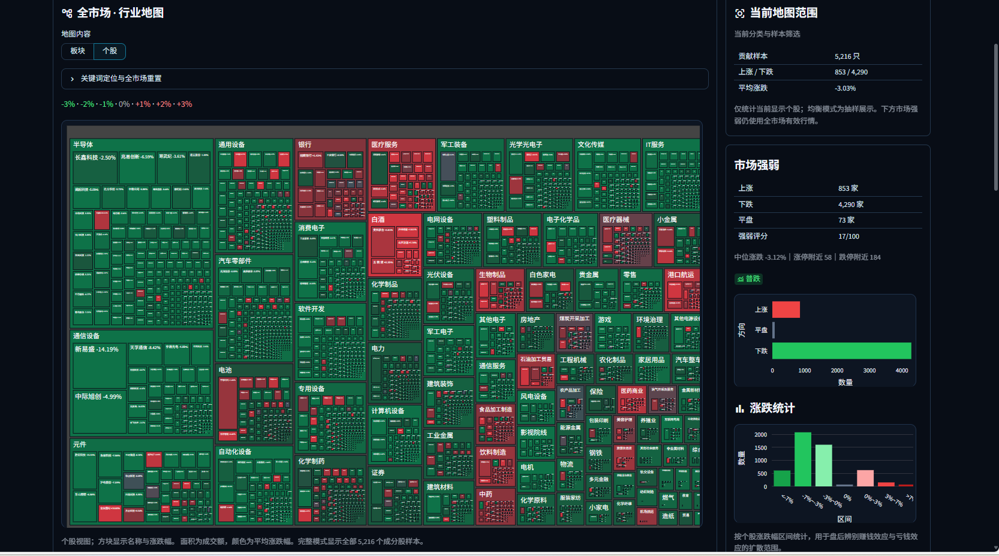
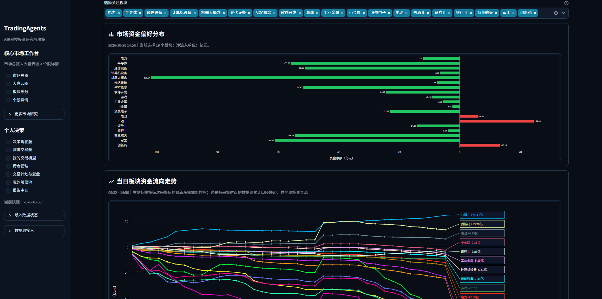
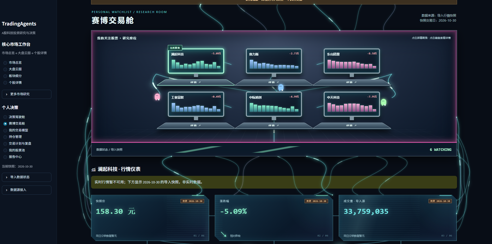
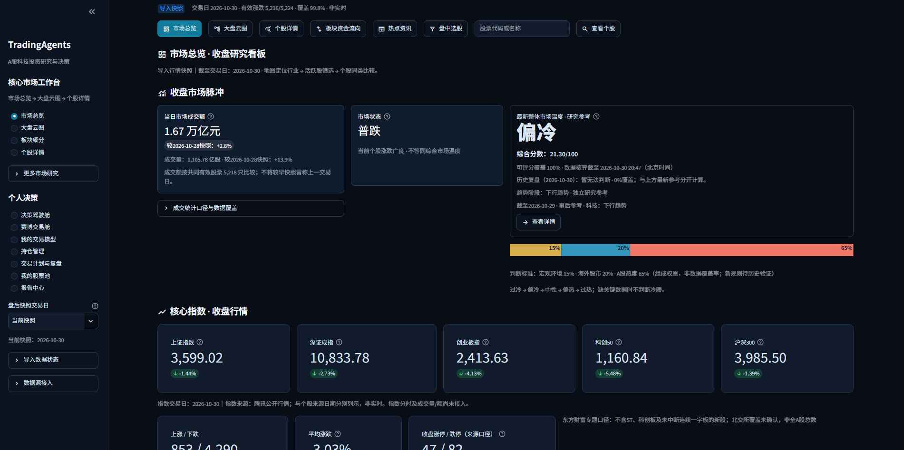
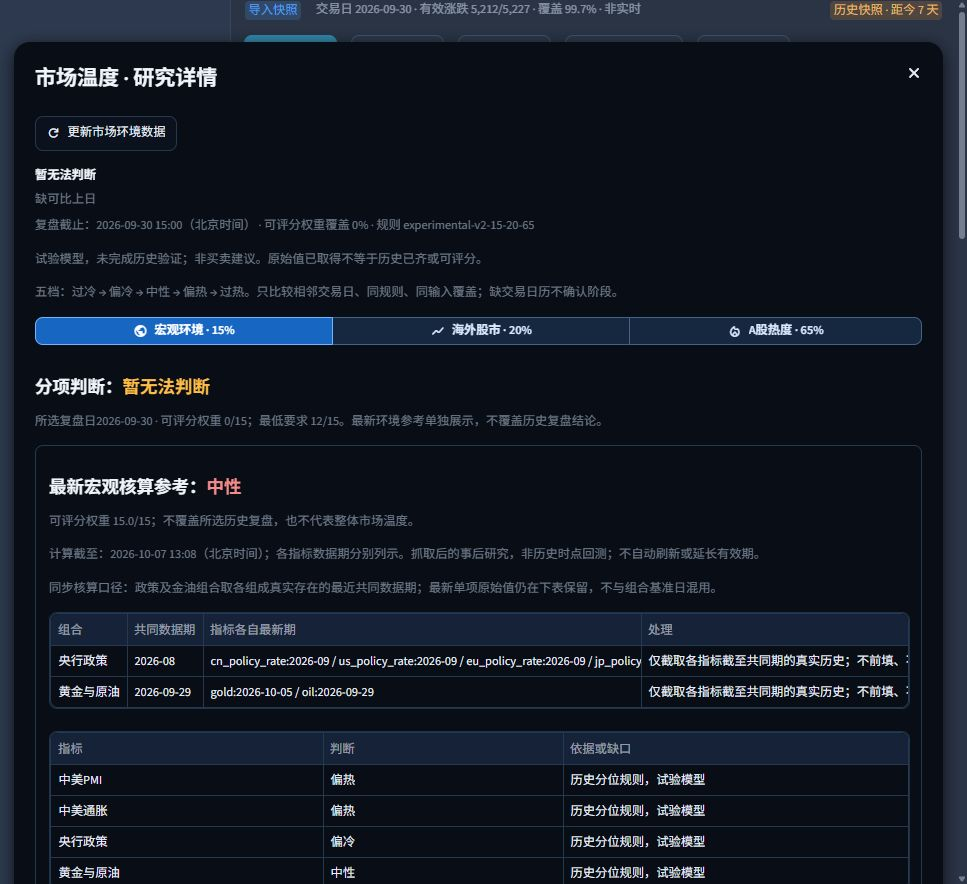
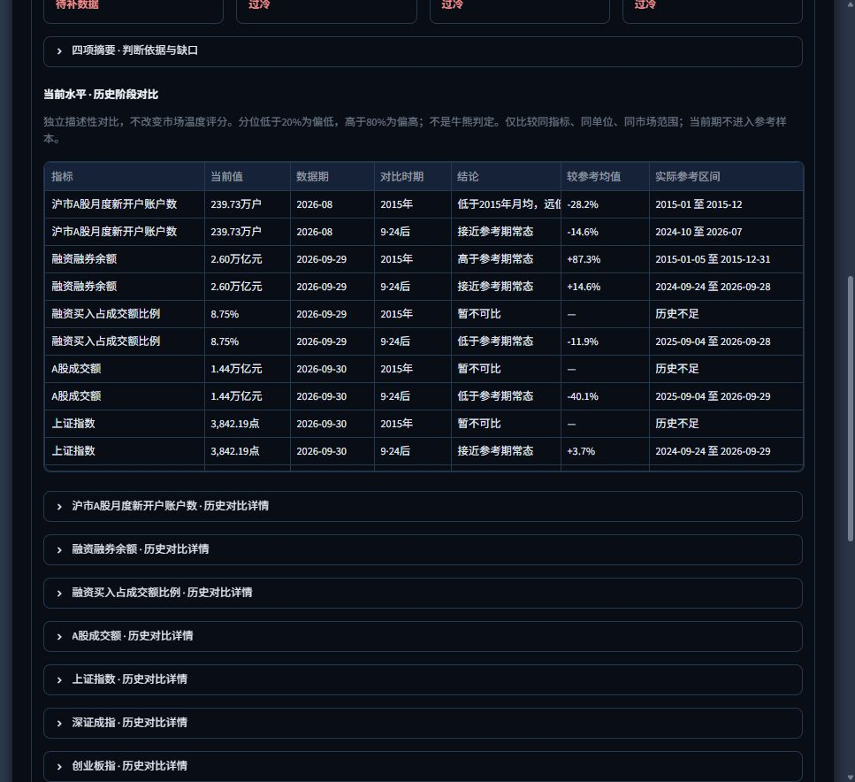
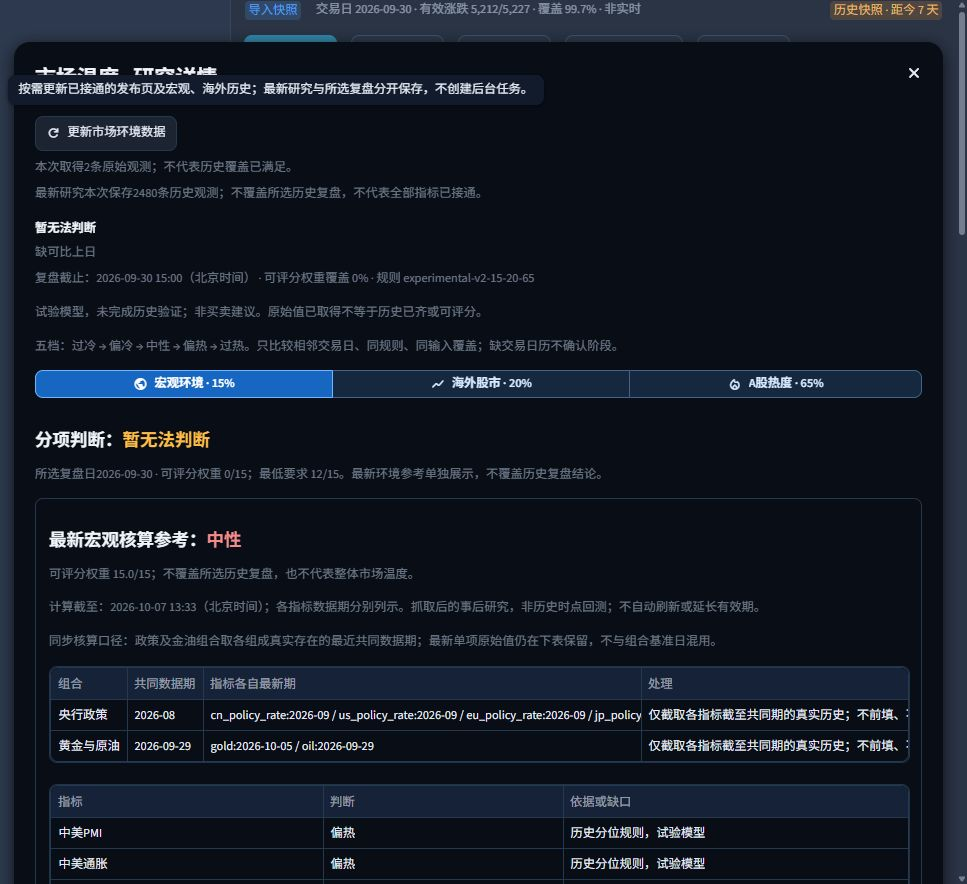
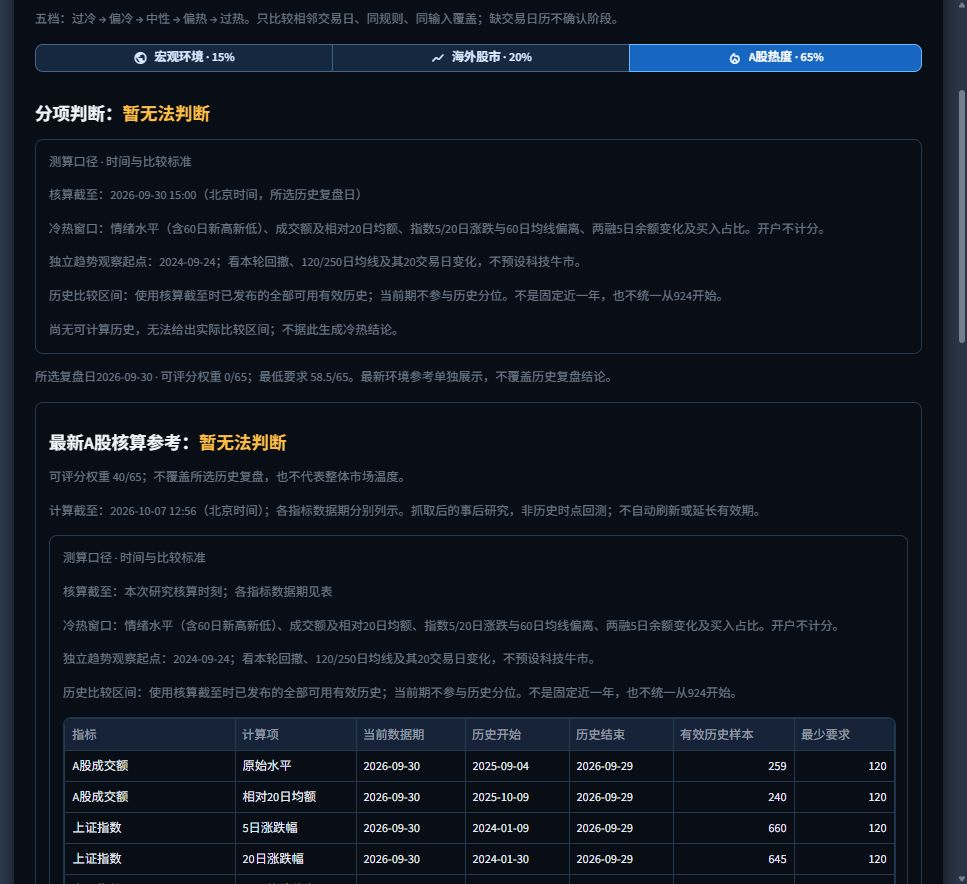
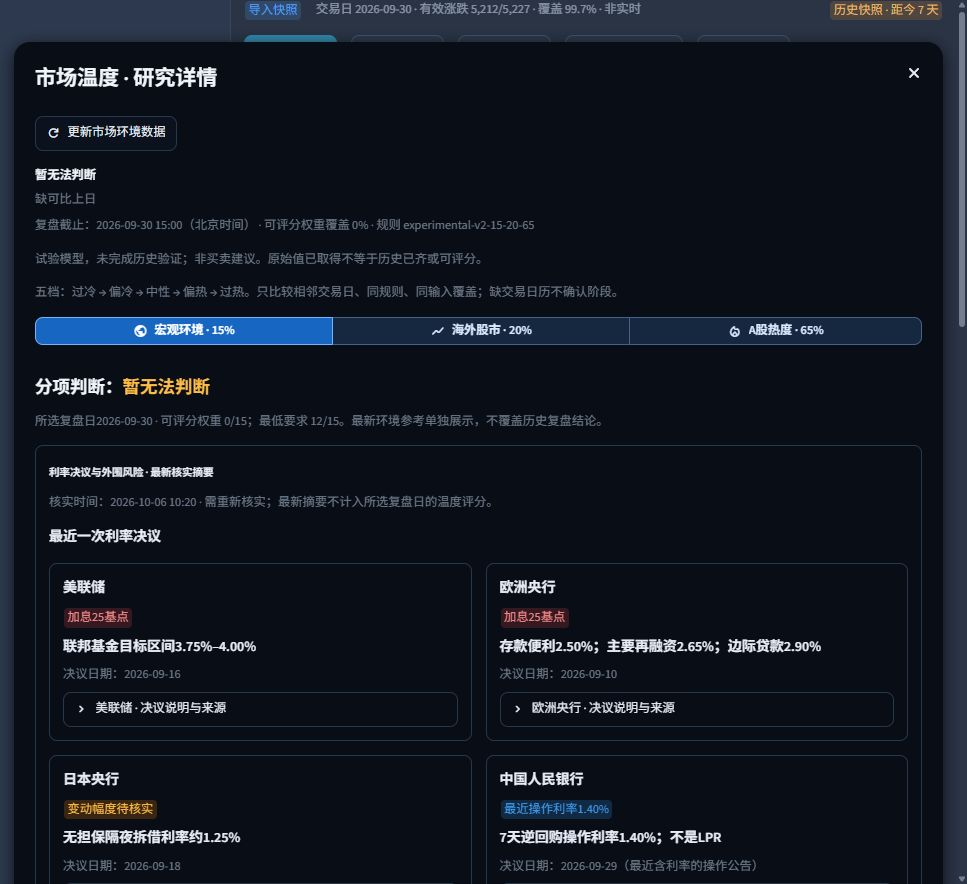

# A 股科技投资决策看板

把市场数据、板块观察和个人复盘放在一处的 Streamlit 研究工具。它帮助整理信息和检查决策纪律，不连接券商账户，也不执行交易。

**市场概览 · 板块资金 · 市场温度 · 历史复盘 · 个股比较**

> 页面截图为历史界面示例，图中的日期和数值不代表当前行情。实际结果以运行时显示的数据日期、来源和覆盖情况为准。

## 一眼看懂

| 看什么 | 能做什么 |
| --- | --- |
| 市场环境 | 分开查看宏观、海外股市和 A 股热度，保留数据期与判断依据 |
| 板块与个股 | 浏览行业、概念和资金流，比较关注的股票与主题 |
| 收盘复盘 | 导入收盘数据，回看历史快照与研究记录 |
| 个人工作区 | 记录交易计划、成交与复盘；本地数据不随源码上传 |

## 界面预览

### 大盘云图：从全市场找到重点

用面积和颜色呈现行业与个股的相对规模、涨跌分布；右侧同步给出上涨下跌家数与市场强弱。先看全局，再进入板块和个股细节。

### 板块资金走势：同时看截面和过程

可选择关注板块，查看同一采集时点的资金偏好分布，并沿真实保存的盘中快照追踪走势。图中标明采集时间；快照不等于逐笔资金流。

### 赛博交易舱：把自选股放进研究工作台

集中展示关注股票和导入的行情快照，从研究卡片进入个股详情，并查看价格、涨跌幅、成交量等指标。截图中的数据为历史导入快照，页面会标注其时效。

### 市场情绪判断：结论和数据依据同屏

收盘研究看板并列展示市场状态、整体环境参考、核心指数和数据覆盖情况，让判断有明确日期和来源。综合分数是研究参考，不构成交易建议。

### 市场温度：先看结论，再看依据

研究详情把宏观环境、海外股市和 A 股热度分开呈现，并显示核算时间、样本和判断口径。数据不足时会提示“暂无法判断”。

| 海外环境与 A 股热度 | 历史对照 |
| --- | --- |
|  |  |

### 数据更新：看清来源和时点

不同来源的数据分别标注更新时间；历史复盘使用相应时点的数据，不把后来取得的数值补作过去的盘中记录。

| 宏观参考 | A 股数据 |
| --- | --- |
|  |  |

| 更新状态 | 研究明细 |
| --- | --- |
|  |  |

这些截图展示界面结构；完整功能请以本地运行的版本为准。

## 快速开始

需要 **Python 3.11**。在项目目录运行：

~~~powershell
python -m pip install -r requirements.txt
python -m streamlit run app.py --server.address 127.0.0.1 --server.port 8505
~~~

打开 <http://127.0.0.1:8505/>。Windows 用户也可以运行 `./run_local.ps1`。

首次启动可以先查看演示界面。真实行情可通过同花顺导出的 CSV/XLSX 文件导入；可选的 Tushare Pro 日线需要自行配置 `TUSHARE_TOKEN` 环境变量。实时或分钟行情应使用具有相应授权的数据服务。导入后请核对页面显示的数据日期、来源和覆盖率。

## 使用路径

1. 导入收盘数据，检查日期、字段和覆盖情况。
2. 查看市场环境、板块资金与关注主题。
3. 比较个股，记录研究依据和交易计划。
4. 收盘后保存复盘，按历史日期回看。

更多页面与操作说明见 [用户指南](docs/USER_GUIDE.md)。数据口径见 [数据源清单](PUBLIC_SOURCES.md) 和 [市场温度说明](docs/market-temperature-sources.md)。

## 部署与数据边界

`deploy/` 包含 systemd 和 Nginx 模板。公网部署前应配置 HTTPS、访问控制和备份。密钥放在环境变量或部署平台的密钥管理中，不要提交到 Git。仓库的 `.gitignore` 排除了本地数据库、导入文件、运行输出和密钥配置。

项目源码采用 [MIT License](LICENSE)。第三方行情、网页内容及用户导入的数据不在该源码许可证范围内；使用和再分发应遵守相应来源的条款。公开发布准备状态见 [PUBLIC_RELEASE.md](PUBLIC_RELEASE.md)。
